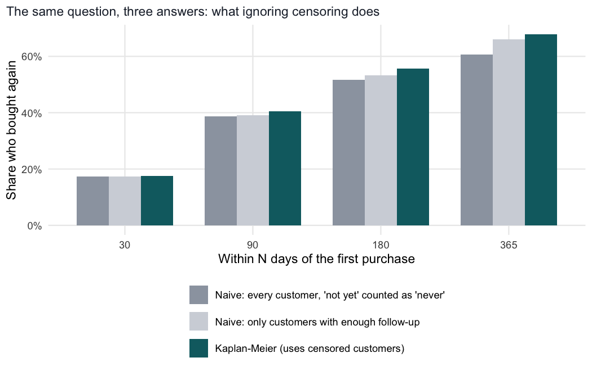
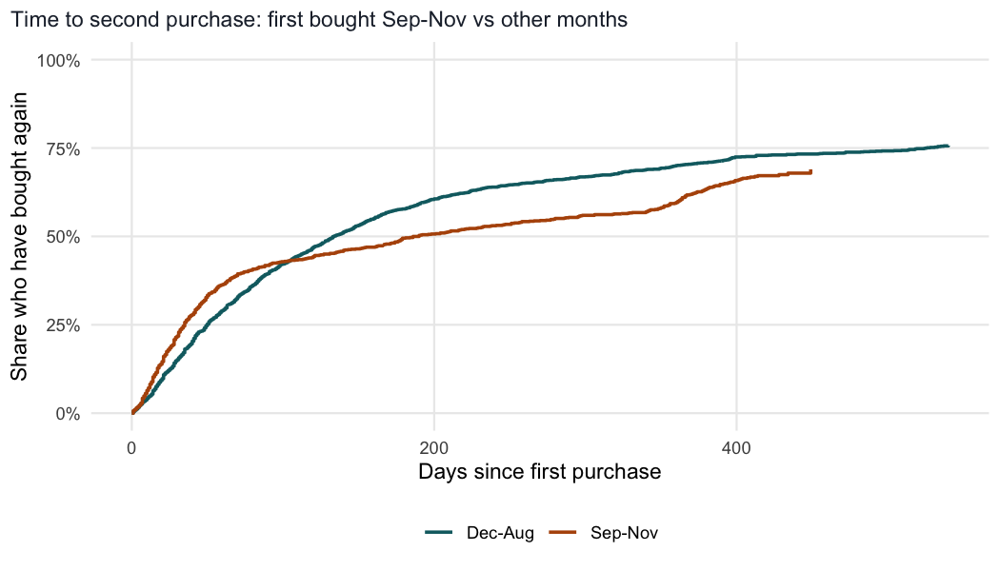

# Repeat Purchase Survival (R)

After a customer's first order, how long until they buy again, and what predicts a faster return? This is a **survival analysis in R** of 4,157 real customers of a UK online wholesaler, using Kaplan–Meier curves, log-rank tests, and a Cox proportional-hazards model with its assumptions checked. The model is evaluated on customers it never saw.

> **Status: learning project (September 2026), local only, not pushed.** It is built, tested (12 `testthat` tests), and run on real data, and I am still practising explaining it. It is also my first R project, so R is a **learning** skill, not a claimed one. The data is one UK gift-ware wholesaler, 2009–2011, so the findings describe that business only.



## Why survival analysis

A customer first seen three weeks before the data ends has had three weeks to come back. The usual "% who returned within a year" counts them as *never* returning, when the truth is *not yet*. Survival methods treat them as **censored** and use exactly the information they carry.

On this data, the question "what share buy again within 365 days?" gets three different answers:

| Method | Within 365 days |
|---|---:|
| Naive, over every customer ("not yet" counted as "never") | 60.7% |
| Naive, only customers who could be followed for a full year | 66.0% |
| **Kaplan–Meier (uses every customer, correctly)** | **67.8%** [66.2, 69.3] |

The first answer is biased low. The second throws away every customer who arrived in the last year, and it assumes they behave like the early ones. Here they don't: early customers came back *less* (53.5% vs 60.0% within 180 days). Kaplan–Meier uses everyone and is the one to report.

**A bug I caught in my own comparison:** the first version of the "full year" rate kept any recent customer who had *already* returned, and dropped the recent customers who hadn't yet. Choosing whom to count based on their outcome pushed it up to 74.1%, above Kaplan–Meier. The fixed version selects customers only by when they arrived, and a test now pins that down.

## Headline results

| | |
|---|---|
| Customers analysed | 4,157 (2,670 bought again, 1,487 censored) |
| Median time to a second purchase | **140 days** |
| Strongest signal | First-order value. Median return is **95 days** (top third), **134** (middle), and **220** (bottom third); log-rank p ≈ 4 × 10⁻²⁵ |
| No difference | UK vs non-UK customers (log-rank p = 0.78) |
| Cox model on held-out customers | Concordance **0.577** (± 0.011). The ranking is real but weak |

## The assumption that broke

A Cox model assumes each factor's effect is **constant over time** (proportional hazards). The check (`cox.zph`) flagged *first bought in Sep–Nov* with p = 2 × 10⁻⁸, and the curves show why: they **cross**.



- Autumn customers come back *faster* in the first ~100 days, while the gift season is still on.
- They then stall for most of the year, and jump again around day 360, the next autumn.

A single hazard ratio for season (0.90) averages those opposite effects into a number that describes neither. The project refits the model stratified by season, and reports the curves rather than that ratio. This is also why the log-rank test for season is weak (p = 0.065): it has little power when curves cross.

## Quickstart

```bash
cd repeat-purchase-survival
Rscript -e 'install.packages("renv"); renv::restore()'   # exact package versions from renv.lock

Rscript tests/run_tests.R                  # 12 tests, offline (~5 s)
Rscript scripts/run.R download             # UCI workbook, SHA-256 verified (~45 MB)
Rscript scripts/run.R analyze              # everything -> outputs/ (~15 s)
```

Details: [docs/results.md](docs/results.md) and [docs/how-it-works.md](docs/how-it-works.md).

## Data

[UCI Online Retail II](https://archive.ics.uci.edu/dataset/502/online+retail+ii), CC BY 4.0. It is the same data as the Python `retail-cohort-analytics` project, with the same cleaning rules re-implemented in R, including the fix for the duplicated rows between the workbook's two sheets.
