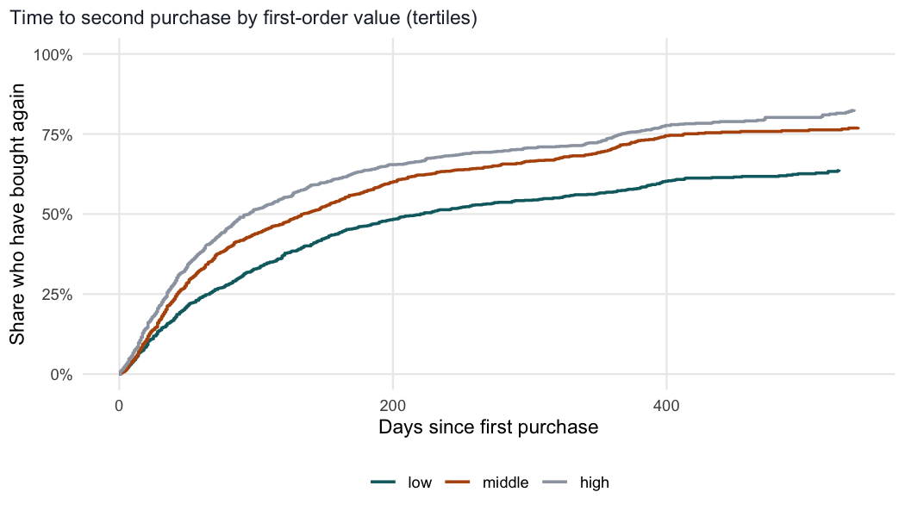
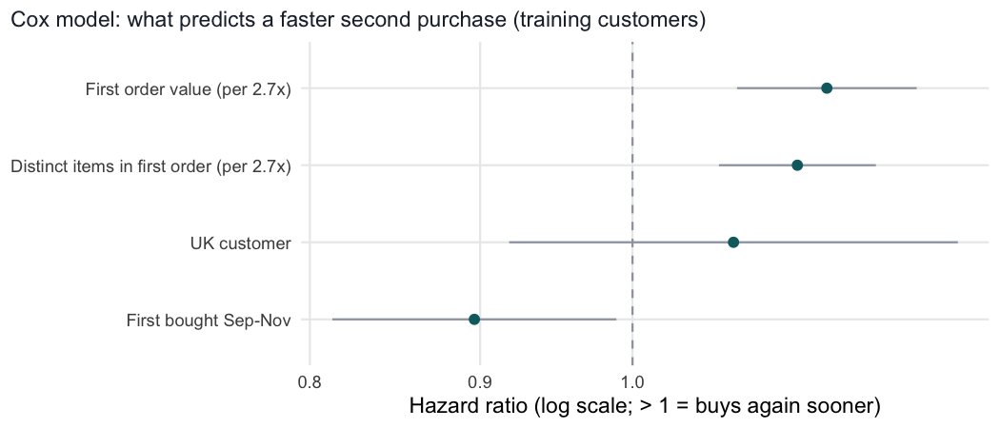
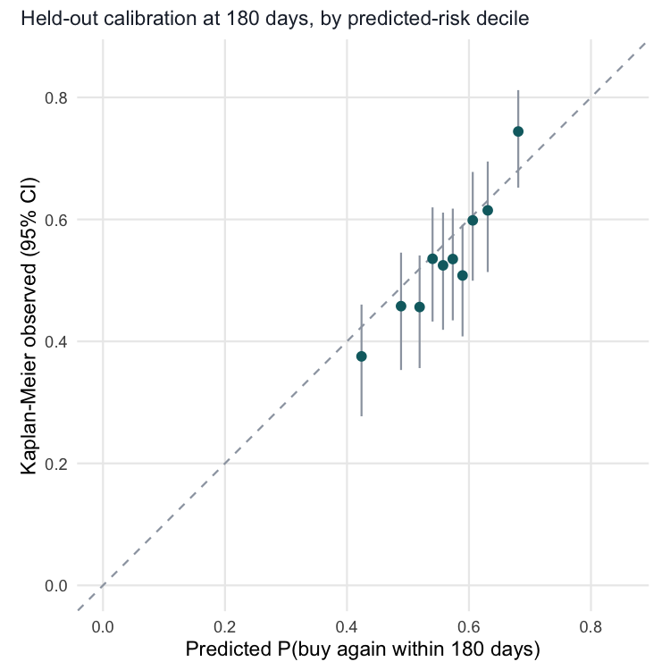

# Results — run of 2026-09-23

Produced by `Rscript scripts/run.R analyze` on the checksum-verified workbook. The customer split uses a fixed seed (2026), so re-running reproduces every number.

## 1. From transactions to customers

- The workbook has 1,044,848 lines after removing the **22,523-row** overlap between its two sheets.
- The cleaning rules are the same as the Python project's: merchandise stock codes, no cancellations, positive quantity and price, and an identified customer.
- There is **one row per customer**:
  - the first purchase day;
  - the first order's value, number of distinct items, and country;
  - `time`, the days until the next purchase on a **later day**. A second invoice on the same day is usually a split or corrected order, not a return visit;
  - `returned`, which is 1 if they came back before the data ends (9 Dec 2011) and 0 if they are censored there.

**Left-censoring guard.** The data starts on 1 Dec 2009, so a customer "first seen" in the opening months may be a long-standing customer whose earlier orders are missing. Customers first seen before **1 March 2010** are excluded. The effect of that choice:

| First seen from | Customers | Median days to return | Returned by day 90 |
|---|---:|---:|---:|
| 1 Dec 2009 (no guard) | 5,851 | 110 | 45.0% |
| **1 Mar 2010 (used)** | **4,157** | **140** | **40.6%** |
| 1 Jun 2010 | 3,167 | 138 | 41.2% |

Without the guard, the pre-existing customers make returns look faster (110 days). Moving the cutoff from March to June changes almost nothing (140 vs 138 days), so three months is enough.

## 2. Censoring bias

| Within | Naive, all customers | Naive, customers followable that long | Kaplan–Meier [95% CI] |
|---|---:|---:|---:|
| 30 days | 17.3% | 17.3% | 17.6% [16.4, 18.7] |
| 90 days | 38.7% | 39.0% | 40.6% [39.0, 42.1] |
| 180 days | 51.6% | 53.3% | 55.7% [54.1, 57.3] |
| 365 days | 60.7% | 66.0% | 67.8% [66.2, 69.3] |

- **Naive, all customers** counts "not yet" as "never", so it falls further below the truth as the horizon grows: 7.1 points low at one year.
- **Naive, followable customers** keeps only customers who arrived at least N days before the data ends (2,591 for the one-year horizon, all first seen between 1 Mar and 9 Dec 2010). It is fair only if early and late customers behave alike. They don't: the early ones returned *less* (Kaplan–Meier within 180 days: 53.5% for customers followable for a year, vs 60.0% for the rest), so it sits a little below Kaplan–Meier.
- **Kaplan–Meier** uses every customer for as long as each was watched.

**A bug caught during this analysis.** The first version of the middle column selected customers whose outcome at the horizon was *known*: those followed long enough, plus recent customers who had already returned. Recent customers who hadn't returned yet were dropped, and those who had were kept. Choosing whom to count by outcome biased it upward, to 74.1% at one year, *above* Kaplan–Meier. The mismatch surfaced when I checked the explanation I had written for it, and found that early customers returned less, not more. The column now depends only on arrival date, and `test-survival.R` would fail on the old rule.

## 3. Groups (Kaplan–Meier, log-rank)

| Group | Customers | Returned | Median days [95% CI] |
|---|---:|---:|---:|
| First-order value, low third | 1,386 | 752 | 220 [190, 265] |
| First-order value, middle third | 1,385 | 925 | 134 [121, 153] |
| First-order value, high third | 1,386 | 993 | **95** [84, 108] |
| UK | 3,748 | 2,409 | 141 [132, 152] |
| Outside UK | 409 | 261 | 130 [103, 169] |
| First bought Dec–Aug | 2,617 | 1,833 | 134 [126, 145] |
| First bought Sep–Nov | 1,540 | 837 | 190 [163, 237] |

Log-rank tests: value χ² = 112.2, p ≈ 4 × 10⁻²⁵; market p = 0.78; season p = 0.065 (low power, because the curves cross; see section 4).

## 4. Cox model (fit on 2,910 customers, evaluated on 1,247)

| Term | Hazard ratio [95% CI] | p | Proportional-hazards check p |
|---|---:|---:|---:|
| log first-order value (per 2.7×) | 1.14 [1.07, 1.22] | 2 × 10⁻⁵ | 0.54 |
| log distinct items in first order (per 2.7×) | 1.12 [1.06, 1.18] | 4 × 10⁻⁵ | 0.22 |
| UK customer | 1.07 [0.92, 1.25] | 0.38 | 0.033 |
| First bought Sep–Nov | 0.90 [0.81, 0.99] | 0.029 | **2 × 10⁻⁸** |

- **Value and basket breadth** both predict a faster return, and their effects are stable over time.
- **Season fails the proportional-hazards check** badly, and its 0.90 should not be quoted as "autumn customers return 10% slower". They return faster early and slower later, so the stratified model replaces it.
- **UK** is borderline on the check (p = 0.033) but has no effect worth modelling.

**Held-out ranking (Harrell's C):** 0.577 ± 0.011 for the main model and 0.578 ± 0.011 stratified by season. Both are clearly better than chance (0.5) but weak. What drives a wholesaler's reorder timing (their own sales cycle and stock levels) is not in this data.

## 5. Calibration at 180 days (held-out customers)

Predicted P(buy again within 180 days) against the Kaplan–Meier observed rate, by predicted-risk decile:
- On average the model predicts **56.1%** against **53.5%** observed, a slight over-prediction of about 2.6 points.
- The largest gap is the 7th decile (58.9% vs 50.8%), which is still inside that decile's 95% interval.
- The top decile is under-predicted (68.1% vs 74.4%).
- The predicted range (42–68%) is narrower than the observed one (38–74%). The model hedges toward the middle, which is consistent with its modest C of 0.58.

## Known limits

- One wholesaler, 2009–2011. Wholesale reorder cycles are not consumer behaviour.
- The left-censoring guard is a heuristic. A three-month window cannot prove a customer is new.
- "Return" means any later purchase, with no minimum size.
- The season effect is described (curves, stratified model) rather than modelled with time-varying coefficients.
